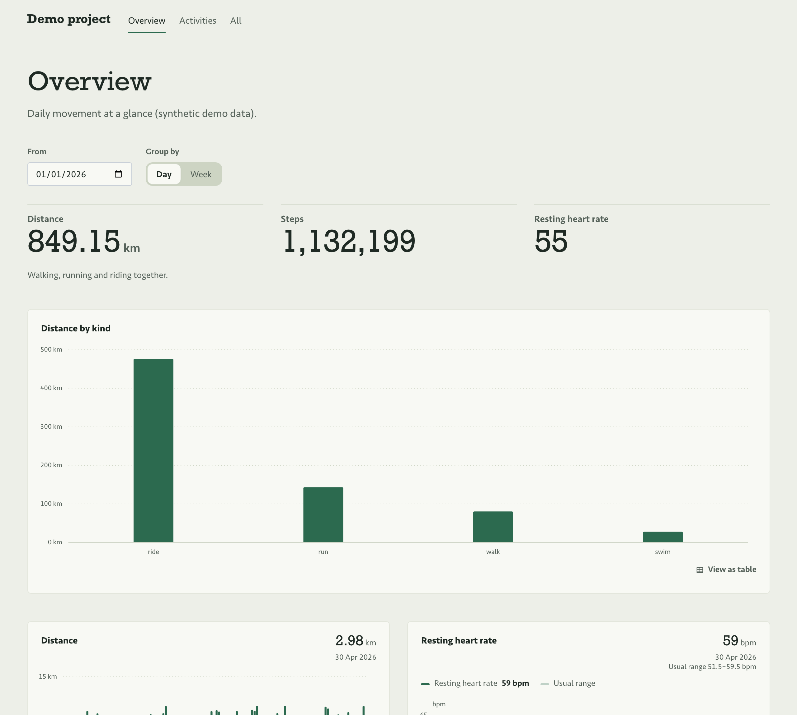
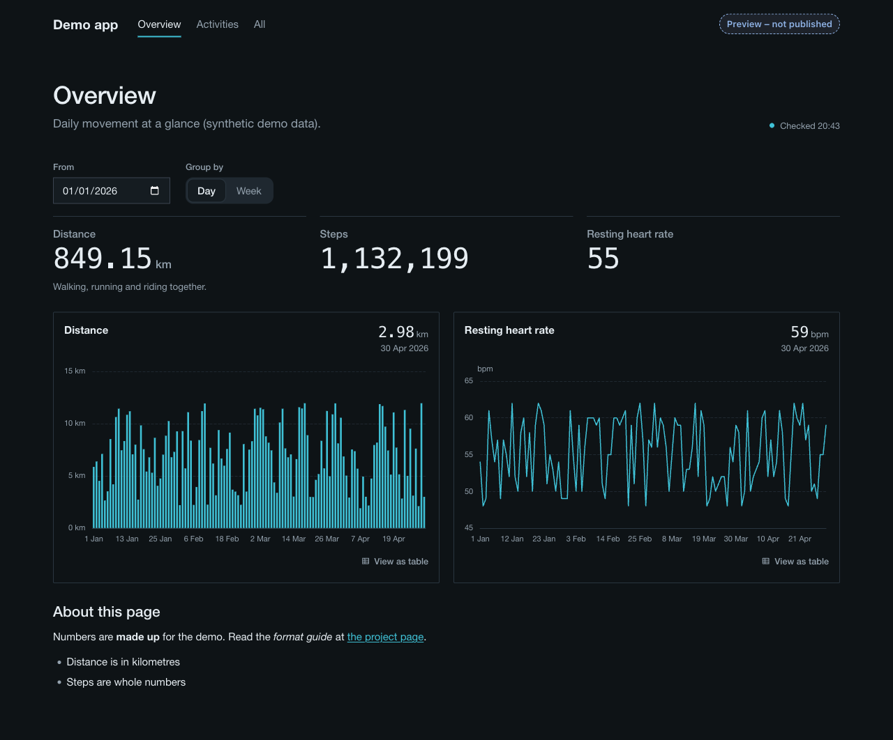
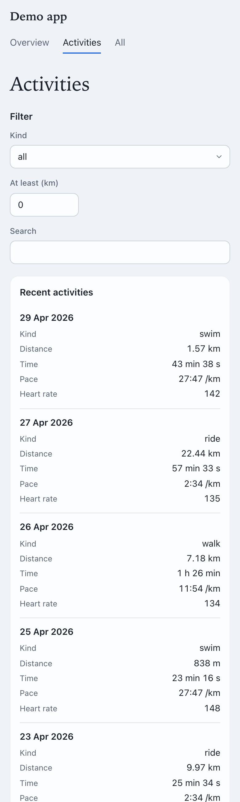
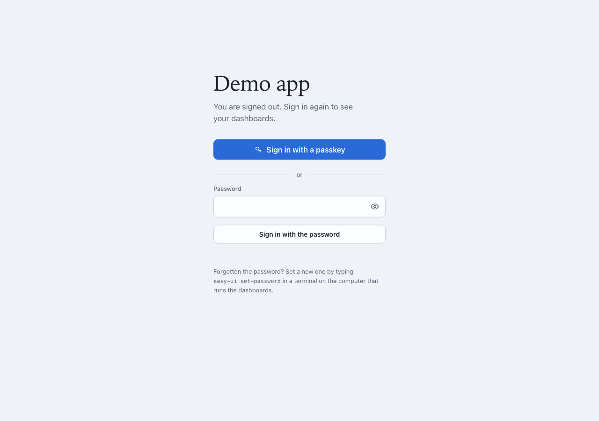

# my-easy-ui

> **Consumer apps should ship APIs that let people consume their own data. People then set up their own
> dashboards and own their data, in an AI-native, fully flexible way.**

A small dashboard server and browser renderer for projects built with **[my-easy-software](https://github.com/josep-reyero/my-easy-software)**. One
server process serves one project.

## The idea

Dashboards are **disposable views**. Your data stays where it is, in your project. A dashboard is a
short YAML file that says which data to read (a few named, read-only SQL queries) and how to show
it (rows of fixed components: numbers, line, area and bar charts, timelines, tables, text and controls).
It contains no JavaScript, HTML or CSS.

Because a dashboard is only a description, you or your AI agent can reshape it whenever your
questions change: add a chart, drop a table, start a new page for this month's goal. There is
nothing to break. `easy-ui validate` explains every mistake in plain words (where it is, what is
allowed, the closest match), and the server re-checks everything before it shows anything.

## How it keeps your data safe

- Dashboards never touch the project's own database. `easy-ui data build` copies only the tables
  listed in `project.toml` into a read-only file, and dashboards read that copy. The copy itself
  treats the project's file as untrusted: it only reads, only the listed tables and views, with a
  time and size limit, and never runs SQL stored in the file (indexes are made again from their
  column lists). When the list of tables grows, `data build` and `publish` say so.
- The server only runs queries that are written in a published dashboard. The browser sends a
  query's name and the control values, never SQL.
- Queries run in a sandbox: read-only and immutable file, one `SELECT` only, no `ATTACH`, no
  `PRAGMA`, no writes, no extension or file functions, values always bound as parameters, a time
  limit, a row limit and a size limit, and small limits on one value (200 KB), on memory (64 MB)
  and on how complex a query may be. Each query runs in a separate worker process that is killed
  when its time is up, so no query can keep running past its limit; a busy server answers "try
  again in a few seconds" instead of queueing. Workers start when needed and stop when idle.
- Sign-in is always required, and the server listens only on this machine. Sign in with a
  passkey (Face ID, Touch ID, Windows Hello, a phone or a security key); the password stays as a
  fallback and can be switched off, and one-time recovery codes cover a lost device.
- A shared copy (`easy-ui export`) holds only what the chosen dashboards show for one set of
  control values (only the columns and rows the components show): no SQL, no tables, nothing of
  the sign-in. The command lists exactly what is in it.

## Try the demo

```sh
easy-ui demo ./easy-ui-demo        # a small project with two apps and made-up data
cd ./easy-ui-demo/app
easy-ui dashboards                 # where each dashboard and section comes from
easy-ui preview                    # prints a link; open it in a browser on this computer
```

The demo project has two tiny apps in `apps/`: `demo_moves` adds a "Distance by kind" section to
the project's overview (after the row the overview marks `- anchor: movement`), and `demo_sleep`
adds a sleep section at its end, with a stylesheet of its own that only touches that section.
The preview shows the dashboards straight from the project's and the apps' files, with no
password and nothing published. Edit a dashboard file and save it: the open page shows the change within a couple of
seconds, or lists what to fix. `easy-ui demo` also prints the commands for the whole journey
below with the demo's own folders.

## Quick start

In a project folder (the one holding `project.toml`, shared with **[my-easy-software](https://github.com/josep-reyero/my-easy-software)**):

```toml
# project.toml
[project]
name = "fitness"                 # lowercase letters, digits and -; at most 24 characters for a server
title = "My fitness"
apps = ["fitness_garmin"]        # the project's apps, by package name, in order

[tables.days]                    # a shared table: several apps may write it (my-easy-software's part)
key = ["date"]
columns = { date = "text", steps = "integer" }

[ui]
accent = "#2f6fdf"               # optional
dashboards = ["overview"]        # optional: menu order; the first is the landing page
refresh_after = ["fitness-garmin.sync"]  # optional, read by mes: jobs after which it runs easy-ui data build
# tables = ["days"]              # optional: fewer tables for the dashboards than the default
```

`easy-ui` reads `[project]`, `[ui]` and the names of `[tables]` and `[views]`; the rest belongs
to **[my-easy-software](https://github.com/josep-reyero/my-easy-software)**. The data is the
project's shared database, `<data folder>/<project>.sqlite`. Dashboards read the shared tables
(through their merged views), the `[views]` and each app's `[ui] tables`, and nothing else.
A setting easy-ui does not know is refused with the closest correct name, or with where it
belongs (jobs, for example, go in the app's own `app.toml`).

Each app is a folder with an `app.toml` (in the project's `apps/<package>/`, or installed
elsewhere and found through `apps.lock.json`, which `mes apps sync` writes). An app's
`[ui] dashboards` are files in its `dashboards/` folder; `[ui.contributes.<dashboard>]` names a
sections file whose sections easy-ui places in another dashboard (at its start, its end, or after
one of its anchors); its `styles/`, `assets/` and `themes/` folders work like the project's, and
its stylesheets apply only to its own dashboards (sections other apps place in them included)
and to the sections it adds elsewhere. The project has the last word:
`ui/dashboards/<name>.yaml` replaces an app's dashboard of that name, and
`ui/sections/<app>.<dashboard>.yaml` replaces (or, with `sections: []`, removes) an app's
sections. `easy-ui dashboards` shows where each piece comes from and what overrides what.
easy-ui reads an app's files only inside its folder, never through a link, and never more than
a set size.

```sh
easy-ui data build        # copy the allowed tables for the dashboards
easy-ui tables            # see the tables and columns, with sample values (--source: the project's file)
easy-ui components        # the whole vocabulary (add --json for agents)
# write ui/dashboards/overview.yaml (see docs/SPEC.md)
easy-ui dashboards        # the dashboards and sections from the project and its apps
easy-ui validate          # check every dashboard against the data
easy-ui preview           # look at it (one-time link, no password, nothing published)
easy-ui publish           # make it the version the server shows
easy-ui set-password      # the person types the first sign-in password (12+ characters)
easy-ui check             # a checklist: not root, private folder, password, data, published
easy-ui serve             # http://127.0.0.1:8765, until you stop it with Ctrl-C
```

`easy-ui rollback` shows the previous published version again; your files in `ui/dashboards/`
stay as they are (the command says so), and `easy-ui rollback N --restore-files` puts version N's
files back so you can edit from there. A version keeps the composed dashboards (with each app's
sections in place), which file and app each piece came from, and the project's own files;
`--restore-files` puts back only the project's own files (an app's files are the app's).

**Passkeys.** After the first sign-in with the password, the page offers to add a passkey
(**Sign-in** in the header: add, name and remove passkeys, switch password sign-in off, make
recovery codes). Passkeys work on `http://localhost:PORT` and over HTTPS (for example behind the
private network's proxy); on other plain-http addresses the page uses the password. Signing in
with a passkey is never slowed down by someone guessing passwords. Removing a passkey, switching
password sign-in on or off and making new recovery codes sign out every other browser. When the
page signed in with the password or a recovery code and a passkey exists, these changes and
adding a passkey are first confirmed with one of the saved passkeys (one added since that
sign-in does not count: sign in with it instead). Only the very first passkey is added with just
the password. So someone who learns the password or one recovery code cannot add a passkey of
their own and take over. From the server's terminal:
`easy-ui passkeys` (list), `easy-ui passkeys remove NAME`, `easy-ui sign-in` (status),
`easy-ui sign-in password on|off`, `easy-ui recovery-codes` (ten one-time codes, shown once on
the terminal only).

**Lost every passkey?** The password or a recovery code still signs you in, but the web page
cannot add a new passkey or change anything else, because nothing is left to confirm with. Fix
it on the server, as the account that runs the dashboards: list the passkeys with
`easy-ui passkeys`, remove each lost one with `easy-ui passkeys remove NAME` (removing the last
one turns password sign-in back on and signs out every browser), then sign in with the password
and add a new passkey, which is a first passkey again. Make new recovery codes then too.

**Passwords and agents.** Only a person can set the sign-in password: `easy-ui set-password`
reads it from the terminal, never from an argument, a variable or a pipe, and answers an agent
with exit code 6 ("needs the human"); so does `easy-ui recovery-codes`. Its prompt states the rule
(at least 12 characters), and a too-short entry or a second entry that differs asks again, three
times in all, before it stops with exit code 2. An agent looks at pages
with `easy-ui preview`, whose link works once (it then prints a new one for the next browser),
or takes a picture with `easy-ui screenshot`. Automated tests set a made-up password with the
library function `easyui.auth.set_password(state.auth, "...")`.

**Restyling.** The look of the dashboards is the project's to change, with three kinds of
files in `ui/`: a theme file (`ui/theme.yaml`: colours for light and dark, fonts, sizes, corners,
spacing, panel and chart style), real CSS (`ui/styles/*.css`, against documented `eui-` names and
custom properties) and fonts and pictures (`ui/assets/`). `easy-ui themes` lists five ready-made
themes and `easy-ui theme use NAME` copies one into the project; `easy-ui style-guide --json`
lists every name an agent can style against; a component's `id:` and `class:` settings give it
hooks, and a dashboard's `theme:` gives it its own colours. Everything is checked by
`easy-ui validate` (no addresses outside the project, no `expression()`, `@import` only of the
project's own files, assets checked by their first bytes), published and rolled back with the
dashboards, reloaded by the preview, and carried by exports. The sign-in, the sign-in settings,
the preview badge and easy-ui's own problem pages always keep easy-ui's look: each dashboard is
drawn in its own document tree that the project's CSS cannot leave. See
[docs/STYLES.md](docs/STYLES.md), which starts with a five-minute walkthrough.

<p>


</p>

**Sharing a copy.** `easy-ui export --out DIR` writes a self-contained folder (`index.html`
and its files) with the published dashboards and the numbers they show for one set of control
values (`--set NAME=VALUE`, `--dashboard NAME`); `--single-file --out FILE.html` writes one HTML
file instead, to open from the disk or send directly. It needs no server and makes no network
request, so it can be opened from the disk or put on any static host (it asks search engines
not to index it). The project's look goes with it: in `ui/` beside the page, or inside the single
file (each stylesheet allowed by its hash in the file's own policy, fonts and pictures as `data:`
addresses; a stylesheet that uses `@import` cannot be carried that way, so a single file is then
refused instead of leaving part of the look out). Every SVG picture is checked again so that it
holds only drawing (no script, link or animation). If the host lets you set headers, also send
`Content-Security-Policy: sandbox` for the `ui/` folder. The command lists exactly what becomes
visible, the look's files included, and nothing else is in it.
With `--encrypt` the data is locked with AES-256-GCM and the key exists only in the link's
ending (`#k=...`), which browsers never send to the host:

```sh
easy-ui export --out ./share --dashboard overview --set since=2026-01-01 --encrypt
```

What the lock protects against, plainly: someone who finds or copies the files without the
link (a disk, a backup, a listing on the host). It does **not** protect against whoever serves
the files: a host could change the page so that it sends the key away the next time someone
opens the link. Put a locked copy only on a host you trust, or send the single file directly.
The page keeps the key only while it is open (never in the browser's storage) and takes it out
of the address bar, but the browser's history may still keep the whole link.
The lock covers the dashboards' titles, texts and numbers, not the project's look: its
stylesheets, fonts and pictures stay readable by anyone with the files (the folder or the single
file), and the command says so. The size of the locked data is not hidden either: anyone with
the files can tell roughly how much the copy holds (a few rows or years of them).

**Pictures for agents.** `easy-ui screenshot [DASHBOARD] --out FILE.png [--phone] [--dark]`
draws the working dashboards (or `--published`) in a headless Chromium-based browser already
installed on this computer (`EASYUI_CHROMIUM` picks one) and saves the whole page; no server,
no password, no network. Pictures are taken at 2 device pixels per CSS pixel, as a high-density
screen shows the page (a 1280 px page gives a 2560 px picture; show it at half its size);
`--scale 1|2|3` changes that. A picture is at most 7680 pixels wide and 16384 high.

**Running it for real.** Started by hand, `easy-ui serve` runs until it is stopped. On a
server, `easy-ui units --render-only --origin https://NAME` writes the systemd socket and service
for the project's web account `mes-<project>-web`: started on the first visit (socket
activation), stopped after 10 minutes without use, and able to read only the project's `ui/`
folder and write only its sign-in folder `/var/lib/mes/<project>/auth/`. It prints the folders,
owners and modes to create (see [Where things live](#where-things-live)); with `--json` it also
gives every value the units use (`exec`, `ui_dir`, `auth_dir`, `socket`, `accounts`, `origins`,
`memory_max`, `exec_start`), for tools that render the units themselves. Commands for the sign-in
on a server run as the web account, for example
`sudo -u mes-fitness-web easy-ui set-password --ui-dir /var/lib/mes/fitness/ui --auth-dir /var/lib/mes/fitness/auth`.

**Web addresses.** The server answers only to the web addresses it is configured with, never to
whatever a request claims, so a page on another port or name cannot borrow a passkey or a
sign-in. Give the exact address the dashboards are opened with (scheme, name and port):

```sh
easy-ui serve --socket /run/mes/fitness-web.sock --origin https://myserver.example.ts.net
easy-ui serve --port 8765 --origin https://myserver.example.ts.net:8443   # behind a proxy on port 8443
```

`--origin` can be repeated; `EASYUI_ORIGINS` (comma-separated) does the same. `--allow-host NAME`
(and `EASYUI_ALLOW_HOSTS`) still works as shorthand for `--origin https://NAME`. When an origin
is given, only those addresses work, and `localhost` does not. Without one, `easy-ui serve --port
PORT` answers only to `http://localhost:PORT` (and `http://127.0.0.1:PORT`, without passkeys) on
exactly that port, and `serve --socket` refuses to start. Passkeys are made for the address's
name (its RP ID) and keep it: a passkey made on `http://localhost:8765` works on
`http://localhost` at any port, one made on `https://myserver.example.ts.net` only there.

**Serving privately.** On a server the dashboards are opened from your other devices through
Tailscale, which forwards to the project's socket:

```sh
tailscale serve --bg --https=443 unix:/run/mes/fitness-web.sock
```

with the server started (by the units from `easy-ui units --origin https://myserver.example.ts.net`) as
`easy-ui serve --ui-dir ... --auth-dir ... --origin https://myserver.example.ts.net`. A proxy that
forwards to a local socket sends `Host: localhost` and the name the browser used in
`X-Forwarded-Host`; on a local socket, and only there, easy-ui checks that single header (a
repeated or malformed one is refused) against `--origin`, and over a TCP port it reads `Host`
alone. Whoever can connect to the socket is trusted to state the host, so keep the socket
owner-only: the systemd socket belongs to root with mode 0600, so only the Tailscale daemon can
connect, and `easy-ui serve --socket PATH` creates it owner-only and refuses a folder other
accounts can write to. Give the socket only to a proxy that sets `X-Forwarded-Host` itself, as
`tailscale serve` does. A request under any other name gets `unknown_host`, and the server's log
says which name it was and which addresses it answers to.

Every command accepts `--json` (only JSON on stdout, errors as JSON), `--project-dir PATH` (the
folder holding `project.toml`), `--ui-dir PATH` (the ui folder alone,
as the web account uses it) and `--auth-dir PATH` (the sign-in folder), before or after the command. Commands that run until stopped (`serve`, `preview`) still print their
result when stopped with Ctrl-C or SIGTERM. Exit codes: 0 ok, 1 error, 2 usage, 3 not found, 4
not allowed, 5 refused for safety, 6 needs you, 75 try again later.

The full dashboard format, with examples, is in [docs/SPEC.md](docs/SPEC.md); the look of the
page is described in [docs/DESIGN.md](docs/DESIGN.md), and how a project changes it in
[docs/STYLES.md](docs/STYLES.md).

<p></p>

<p>


</p>

## Where things live

On your own computer:

- The project's data: `~/.local/share/mes/<project>/` (`MES_DATA_HOME` changes the base), or the
  folder named for this computer in `~/.config/mes/config.toml` (`MES_CONFIG` names another file):

  ```toml
  [projects.fitness]
  data_dir = "~/Documents/fitness-archive"
  ```

  `easy-ui` only reads it.
- easy-ui's own folder (the *ui folder*): `~/.local/state/mes/<project>/ui/` (`MES_STATE_HOME`
  changes the base; `EASYUI_STATE_HOME`, mostly for tests, makes it `$EASYUI_STATE_HOME/<project>/`), with `data/` (the dashboard data copies and the
  `current` link), `specs/` (published dashboard versions) and `project.json` (the name, title,
  accent and menu order, so the server never needs `project.toml`). To start over, delete that folder.
- The sign-in folder (password hash, passkeys, recovery codes, sessions), beside the ui folder:
  `~/.local/state/mes/<project>/auth/` (with `EASYUI_STATE_HOME`, for tests, inside the ui folder:
  `$EASYUI_STATE_HOME/<project>/auth/`; `--auth-dir PATH` names another one). The commands that use it refuse a sign-in folder that is
  a link, belongs to another account, is not mode 0700 or sits in a folder another account can
  change.
- Sample data for the preview: `ui/fixtures/*.sqlite`, `*.sqlite3` or `*.db` in the project
  (made-up data only), used when the project has no data yet or with `easy-ui preview --fixture`.

On a server (`MES_ROOT=/var/lib/mes`, set by **[my-easy-software](https://github.com/josep-reyero/my-easy-software)** for its jobs):

| Folder | Owner : group | Mode | Why |
| --- | --- | --- | --- |
| `/var/lib/mes/<p>` | `root` : `root` | 0711 | only root may add, rename or replace what is in it |
| `/var/lib/mes/<p>/data` | (**[my-easy-software](https://github.com/josep-reyero/my-easy-software)**) | | the project's own data; the web account cannot enter |
| `/var/lib/mes/<p>/ui`, `ui/data`, `ui/specs` | `mes-<p>` : `mes-<p>-web` | 2750 | written by the jobs (`data build`, `publish`), read by the web account |
| `/var/lib/mes/<p>/auth` | `mes-<p>-web` : `mes-<p>-web` | 0700 | the sign-in, written only by the web account; beside `ui/`, never inside it |

`data build` and `publish` keep what they write readable by that group whatever the umask. The
web account reads everything under `ui/` without following links, because the project's account
writes that folder. The sign-in folder is always beside `ui/`, never inside it, on a personal
machine too: easy-ui never reads sign-in data from inside `ui/`, which the project's account
could change. The
service sees nothing else under `/var/lib/mes` (it is hidden from it), and `easy-ui` itself must
be installed outside `/var/lib/mes` and outside home folders (for example `/usr/local/bin`).

## Status

v1. Everything above works: the dashboard format and its checks, the data copy, the query
sandbox, publishing with versions and rollback, the server with passkeys, password and recovery
codes, the browser page, themes and project stylesheets, the preview, static exports, pictures, the systemd files, and
dashboards, sections and looks contributed by a project's apps. Known
limits: formatting is English-style only (`1,234.5`, `14 Mar 2026`); charts space points evenly
(one per row; missing days and weeks of a regular daily or weekly series become gaps), which
suits daily and weekly series; a browser that has never signed in can be
kept from signing in *with the password* by someone on the private network who keeps sending
wrong passwords (passkeys and recovery codes are not affected); passkeys need `localhost` or
HTTPS and work only on the configured web addresses; a shared copy shows one set of control values. Tested with Chromium; not yet with Safari
or Firefox; the systemd files are checked by tests, not yet on a real server.

## Installing

Install from a copy of this repository with the exact versions it was tested with
(`uv.lock` pins every dependency and its hash):

```sh
uv sync --locked --no-dev        # in the repository folder; fails instead of changing the lock
uv run --locked easy-ui --help
```

For a command on the path (on a server: outside `/var/lib/mes` and outside home folders), make a
virtual environment and install the locked versions into it, each checked against its hash:

```sh
uv export --locked --no-dev --no-emit-project --format requirements-txt > /tmp/easy-ui-requirements.txt
uv venv /opt/easy-ui
uv pip install --python /opt/easy-ui --require-hashes -r /tmp/easy-ui-requirements.txt
uv pip install --python /opt/easy-ui --no-deps .
ln -s /opt/easy-ui/bin/easy-ui /usr/local/bin/easy-ui
```

 `easy-ui serve`, `preview` and `export` check the chart library's file against
the hash it was shipped with before they start, and the page asks the browser to check it too.

## Development

```sh
uv sync --locked
uv run pytest
```

Python 3.12 or newer. Runtime dependencies: starlette, uvicorn, argon2-cffi, PyYAML and
cryptography (passkey signatures and locked exports). The passkey checks are written here (no
WebAuthn library) and tested against a recorded browser ceremony.


## Related projects

This is one piece of a small family of projects that work together or on their own:

- **[my-easy-software](https://github.com/josep-reyero/my-easy-software)**: the framework: create, run, deploy and share small personal projects with the `mes` command.
- **[my-bucket-storage](https://github.com/josep-reyero/my-bucket-storage)**: storage: a small object store with no server process that takes little disk space.
- **[fitdata](https://github.com/josep-reyero/fitdata)**: the first project built this way: a personal Garmin data archive with a command line for agents.

## License

MIT
