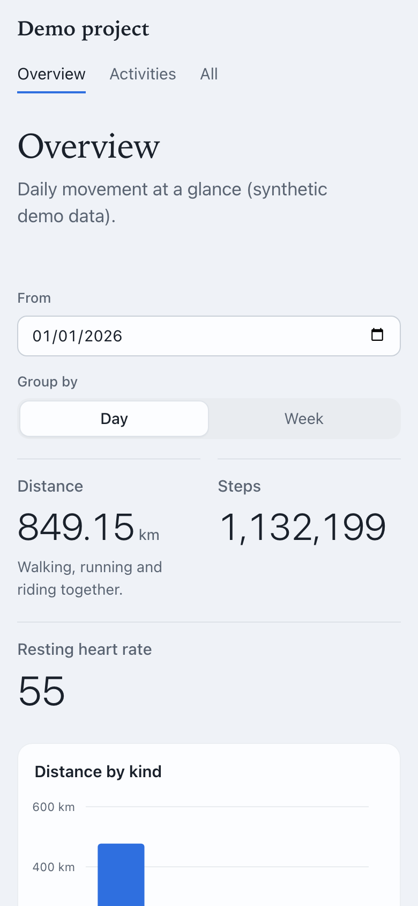
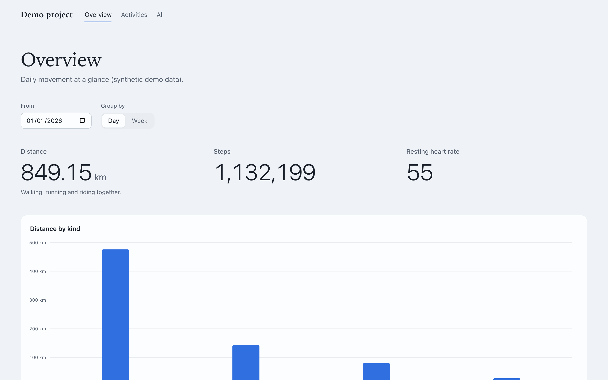
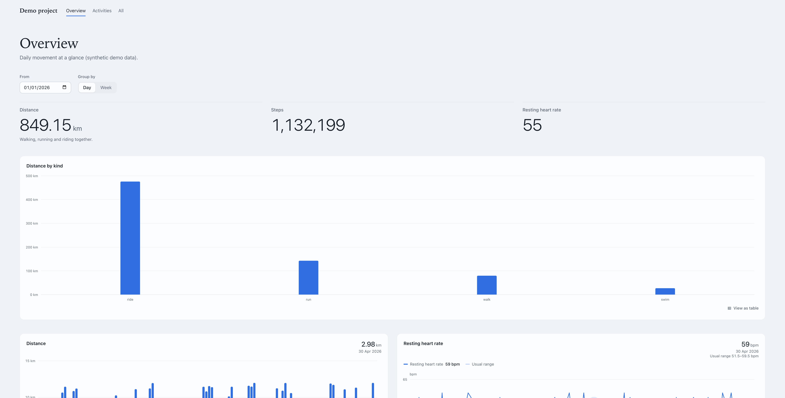

# Visual language

The dashboard page is something a person opens every morning to see how things are going. It
should feel like a calm, well-set almanac of their own numbers: quiet chrome, big honest figures,
charts without decoration.

**Colour.** A cool, misty neutral base with one accent, the project's own (`[ui] accent` in
`project.toml`). The accent tints the page very slightly, so every app feels like itself, and it marks
the few things that matter: the current page, the main data series, links, focus rings. Light and
dark follow the system setting. Neutrals are hex tokens in `style.css` (`--base-*`). `theme.js`
mixes in the accent in OKLab and nudges it until text reaches 4.5:1 contrast and chart marks reach
3:1, whatever colour the app picks. Further chart series turn around the hue circle at the same
calm lightness. Errors use one muted red. Nothing else is coloured.

**Type.** System fonts only. Page and section headings use a book serif (Iowan Old Style, then
Palatino and its look-alikes). Everything else uses the system sans. Numbers are the main thing on
the page: stats are large, light and tabular, with the unit set smaller beside them (`849.15 km`).
Labels are sentence case and never all caps. A date or a word in a stat is set smaller than a
number. Times are 24-hour ("Checked 16:03"), like the English dates ("4 May 2026").

**Changes.** The small change under a stat is neutral grey: a rise is not always good news. When
the dashboard says which way is good (`better: higher | lower`), a good change takes the accent
colour and a bad one the muted red, and screen readers hear "up (better)" or "down (worse)".

**Layout.** The page uses the whole width it is given, from a 320 px phone to an ultrawide screen,
with gutters that grow with it (and room for a phone's rounded corners), and generous space between
rows. A row's components share its width evenly: as many side by side as fit at their smallest
comfortable width (about 8.5 rem for a number, 19 rem for a chart, 24 rem for a table), spread over
balanced lines when they do not all fit (six numbers go six, three and three, or two, two and two;
three charts go three, or two and one as wide as the line). This follows the dashboard's own box,
not the screen, so it holds in a split window, after a zoom and on a turned phone. Inside a
component, its own width decides: a figure shrinks to fit a narrow tile, a table becomes cards, a
chart grows taller. When the menu's links do not fit across, they fold into one button that names
the current page and opens them as a list. The page
opens on the first dashboard of the project's order (`[ui] dashboards`), also in a shared copy; "All" in the menu lists
every dashboard with its description. Stats
sit straight on the page under a hairline. Charts and tables sit on slightly raised panels with no
shadow. Text is plain prose, at most 66 characters wide, however wide the page.

**Charts.** Drawn as SVG, so they are as sharp as the text at every pixel density and zoom level,
and their labels use the page's fonts with figures of equal width. Quiet axes: no tick marks, a
baseline only under bars, three to five faint gridlines (fewer on a short chart), small grey
labels, and round steps for times and distances (0, 30 min, 1 h; 0, 20 km, 40 km), or the
dashboard's own `step:`. The value axis leaves a little room above the highest value (and below
the lowest on a line), so a line never runs along the edge; bars and areas start from zero. One
short form per axis (15k, 10k, 5k, 0). A chart's `unit` (bpm) is written once above the axis
rather than on every label. Dates are labelled on natural boundaries, the finest that fits
without crowding: days, Mondays, every other Monday, the first of each month, quarters or years,
with the year where a chart crosses one. Lines are 2 px with round joins, straight between
points (no smoothing that would invent values), with no dots until the pointer is on them; a
missing day leaves a gap instead of a line across it, and a value alone between gaps gets a dot.
Areas fade from the line down. Bars have rounded tops (only the top of a stack), comfortable gaps
and a largest width, so four categories on a wide screen are not slabs. A band (a usual range)
is a soft fill behind a line, a reference (a goal) a thin dashed line with its label on the
panel's colour. On a date axis a readout in the chart heading shows the latest value, and
while the pointer moves it shows the value under it; on a category axis ("run", "walk") it only
shows the value under the pointer, because no category is "the latest". `readout: pointer`
keeps the heading empty until the pointer is on the chart, `readout: none` leaves it out. A
period still in progress (`partial:`, this week so far) is drawn lighter (bars) or with a dashed
line into an open point, and its readout says "so far", so a short week does not look like a
bad one. With
several series, a small legend carries the values (a short line for lines, a square for bars, a
dash for a dashed series), and a small card beside the pointer, in the panel's colour, corner and
shadow, lists the date and every value (with the total of a stack). A chart with nothing to
draw keeps its place, with faint gridlines behind a short note. A timeline gives each category
its own lane, and its legend says how long each one lasted. Every chart can switch to a table
("View as table", newest first), which also serves screen readers.

**States.** Loading keeps the space with a soft placeholder that only fades in when loading takes a
moment. On later loads the old content stays and dims. Empty and error states say what happened
and what to do, in the component's own space. "No data yet" is only for a query without
controls; when controls narrow it down, it says "Nothing matches these settings" and offers to
reset them. "Checked" only moves when a load worked; when the server does not answer, the page
says so. A data problem that affects the whole page shows
once, as a note at the top. While the person is away, the page says it is paused instead of
checking again and again.

**Motion and access.** One short draw-in animation for charts (under 0.4 s, only the first time;
a resize or a new theme redraws at once), nothing else moves on its own, and reduced motion
switches it off. Focus is always visible. In a narrow component (a phone, or half of a tablet), each table row becomes a small
card: the first column as its heading, then one "label  value" line per column, with no sideways
scrolling (`phone: scroll` keeps the table, which then scrolls sideways inside its panel with a
fade on the right edge while more columns are off to the side; so do wide tables on larger
screens).

**Preview.** A preview (`easy-ui preview`) says "Preview – not published" where Sign out would be
(it has no password to sign back in with), and checks for saved changes every 1.5 seconds.
Radio buttons and selects are native controls, and links in text open in a new tab, which is
announced to screen readers.

**Sign-in.** The passkey button comes first and is the main action; the password form sits
under "or" as a quieter second choice, and "Use a recovery code" is a small link. When the
password is switched off, only the passkey and the recovery code remain. After the first
password sign-in the page offers, once, to add a passkey. "Sign-in" in the header opens the
settings: passkeys (name, when added, when last used, remove in two steps), the password switch,
and recovery codes, shown once in a monospaced grid with Copy and "I have saved them". Changing
any of these asks for a sign-in within the last ten minutes. When the page signed in with the
password or a recovery code and a passkey is saved, every change, adding a passkey too, first asks
the device for one of the saved passkeys; a passkey added since that sign-in cannot confirm it,
and the page says to sign in with it instead.

**Shared copy.** A copy made by `easy-ui export` says "Shared copy · 16 Nov 2026" where Sign out
would be. Its controls are shown as plain values ("From 1 Jan 2026 · Group by Week") with a note
that the copy shows the numbers for these settings, since it holds no others. A locked copy
opened without its key says so and how to get the whole link, never showing an empty page.
Pictures from `easy-ui screenshot` look like the live page (no badge, real inputs).
