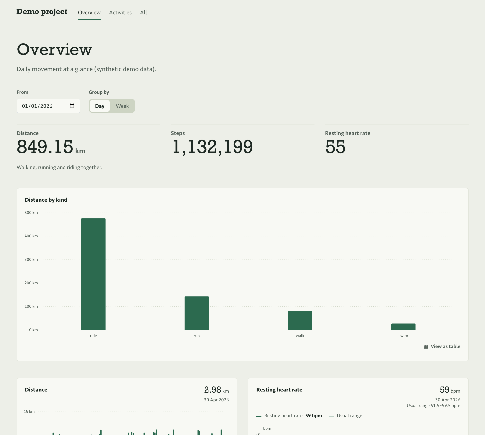
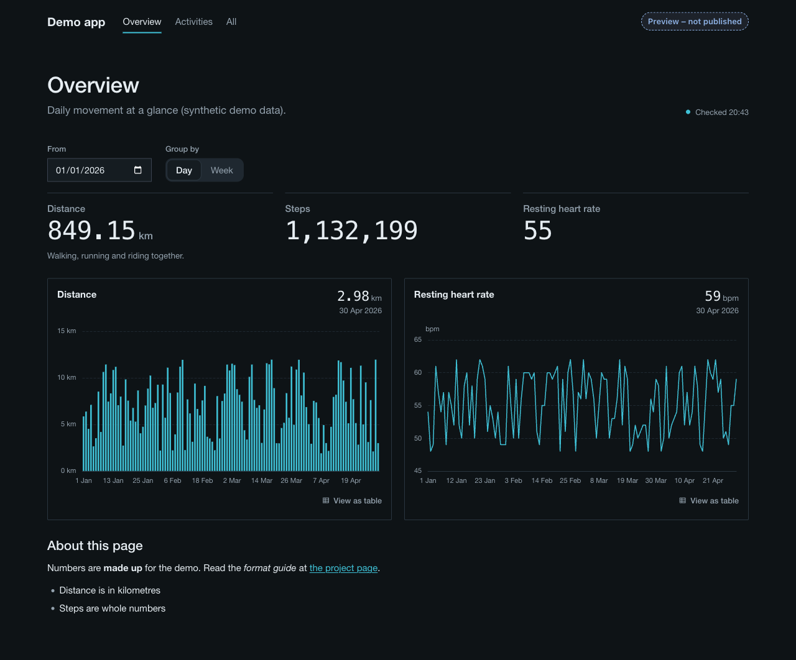
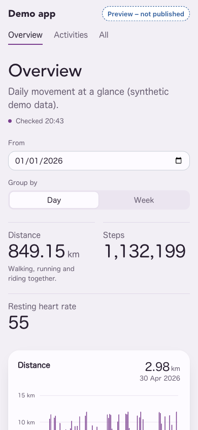

# Styles: fully flexible, still safe

Dashboards are fully flexible in what they show; this page is about how they look. A person or
their agent can restyle anything with real CSS, and change colours and fonts with a small theme
file. easy-ui checks every one of these files before it is used, publishes it together with the
dashboards, and keeps it away from easy-ui's own screens.

Three kinds of files in the project's `ui/` folder make up the *look*:

| File | What it is |
| --- | --- |
| `ui/theme.yaml` | Named settings, no CSS: colours (light and dark), fonts, text size, corners, spacing, panel style, chart lines. |
| `ui/styles/*.css` | Ordinary CSS, applied after easy-ui's own styles in file-name order (`10-layout.css` before `20-type.css`). |
| `ui/assets/` | `.woff2` fonts and `.png`, `.jpg`, `.webp` and `.svg` pictures, for the theme and the stylesheets. |

Every one of them is optional. Without any, dashboards look as they always did.



<p>


</p>

## Restyle a dashboard in five minutes

A walkthrough for an agent (or a person) working in a project folder. Every step can be checked
from the terminal, and nothing is visible to anyone until `easy-ui publish`.

1. **See what can be styled.** `easy-ui style-guide --json` lists every class, data attribute,
   custom property and theme setting, with a description of each. `easy-ui themes` lists the
   ready-made themes.

2. **Start from a theme.** Copy one into the project, then change what you like in it:

   ```sh
   easy-ui theme use trail          # writes ui/theme.yaml; never overwrites one without --force
   easy-ui preview                  # prints a link; the page reloads by itself on every save
   ```

   ```yaml
   # ui/theme.yaml (excerpt)
   colors:
     accent: "#2c6a4f"              # colours in quotes: YAML reads an unquoted # as a comment
     chart: ["#2c6a4f", "#b07d22", "#4f78a0"]
   dark:
     accent: "#78c29c"
   fonts:
     headings: slab                 # a built-in stack, or a family from font_files
     numbers: mono
   radius: 6
   density: compact
   cards: outline
   chart:
     grid: dotted
   ```

3. **Change the layout and type with CSS.** Write `ui/styles/10-look.css`:

   ```css
   @font-face { font-family: "Field Notes"; src: url("../assets/fonts/field-notes.woff2") format("woff2"); }
   .eui-app { --eui-font-heading: "Field Notes", serif; }
   .eui-dashboard-title { font-size: 4.5rem; font-style: italic; }
   .eui-row[data-row="3"] { display: grid; grid-template-columns: 1fr; }   /* the third row: one chart per line */
   @media (max-width: 560px) { .eui-row { gap: 12px; } }
   ```

4. **Restyle one chart.** Give the component an id in its dashboard file, then set the chart's
   custom properties on it. Only that chart changes:

   ```yaml
   - type: line
     id: heart
     class: vital
     title: Resting heart rate
     query: heart
     x: day
     y: [Resting heart rate]
   ```

   ```css
   [data-id="heart"] {
     --eui-chart-1: #b0383a;
     --eui-chart-line-width: 4;
     --eui-chart-grid-style: dashed;
     --eui-chart-height: 340px;
   }
   .eui-component.vital .eui-title { color: #b0383a; }
   ```

5. **One dashboard, its own colours.** A dashboard file can override the theme for itself only:

   ```yaml
   theme:
     colors:
       accent: "#a2451d"            # light mode; dark mode under dark:
     cards: outline
   ```

6. **Check, look, publish.**

   ```sh
   easy-ui validate                              # dashboards and the look; unknown eui- names come with "did you mean"
   easy-ui screenshot overview --out a.png       # also --phone and --dark
   easy-ui publish                               # the dashboards and the look become one new version
   easy-ui rollback                              # brings back the previous version, look included
   ```

## The theme file

`ui/theme.yaml` holds named settings only. Each one becomes a CSS custom property (`--eui-...`)
in a stylesheet easy-ui generates (`ui/theme.css` as the browser sees it), for light and dark
mode. Unknown settings are errors, with the closest correct name.

| Setting | What it is |
| --- | --- |
| `name`, `description` | A short name and one sentence. |
| `colors` | Light mode: `accent`, `background`, `surface`, `text`, `muted`, `border`, `grid`, `good`, `bad`, and `chart` (1 to 8 series colours). `#rgb` or `#rrggbb`, in quotes. |
| `dark` | The same colours for dark mode. Colours left out use easy-ui's dark values (the accent uses the light one). |
| `fonts` | `body`, `headings`, `numbers`: a built-in stack (`system-sans`, `book`, `transitional`, `didone`, `slab`, `humanist`, `geometric`, `grotesque`, `rounded`, `mono`) or a family from `font_files`. |
| `font_files` | Families the project ships: `Family: [{file: fonts/x.woff2, weight: 400, style: normal}]`, with files in `ui/assets/`. |
| `type` | `size` (base text size, 12 to 22 px) and `scale` (how much larger each heading step is, 1.1 to 1.6). |
| `radius` | Panel corners, 0 to 32 px. |
| `density` | `compact`, `normal` or `roomy`. |
| `cards` | `flat`, `outline`, `raised` or `plain`. |
| `chart` | `line_width` (0.5 to 6), `grid` (`solid`, `dashed`, `dotted`, `none`), `area_opacity` (0 to 1), `bar_radius` (0 to 12). |

`easy-ui validate` warns when colours are hard to read together: text against panels below 4.5:1,
secondary text, the accent, good and bad below 3:1, chart colours below 2:1. A warning does not
stop publishing.

A dashboard's own `theme:` takes `colors`, `dark`, `fonts`, `type`, `radius`, `density`, `cards`
and `chart`, and applies to that dashboard only.

Ready-made themes ship with easy-ui; each has a light and a dark palette and works at phone width:

| Theme | Character |
| --- | --- |
| `almanac` | easy-ui's own look as a theme: calm blue, book-serif headings. |
| `trail` | A field map: sage paper, pine and ochre, slab-serif figures, dotted gridlines. |
| `instrument` | A lab instrument: cold grey and teal, compact, monospaced figures, outlined panels, square corners. |
| `dusk` | Lavender and plum, rounded type, roomy spacing, soft raised panels. |
| `harbour` | Chalk blue and navy, high-contrast display-serif headings, no panels at all. |

## Stable names to style against

Documented and kept stable across versions: renaming one is a breaking change.
`easy-ui style-guide` prints all of them with a description.

- **Dashboard area:** `.eui-app` (with `data-project` and `data-theme="light|dark"`),
  `.eui-dashboard` (with `data-dashboard="<slug>"`), `.eui-dashboard-title`,
  `.eui-dashboard-description`, `.eui-status`.
- **Layout:** `.eui-row` with `data-row="N"` (1 for the first row).
- **Components:** `.eui-component` with `data-type="stat|line|area|bar|table|text|controls"` and
  `data-id="<id>"` (the `id:` setting, or `r<row>c<column>` counted from 0), plus the classes of
  its `class:` setting.
- **Parts:** `.eui-title`, `.eui-value`, `.eui-unit`, `.eui-delta`, `.eui-hint`, `.eui-chart`,
  `.eui-readout`, `.eui-legend`, `.eui-table`, `.eui-th`, `.eui-td`, `.eui-text`, `.eui-control`,
  `.eui-empty`, `.eui-error`.

Every component takes two more settings in its dashboard file:

- `id:` a stable name, lowercase letters, digits and `-`, starting with a letter, unique in the
  dashboard (not of the form `r1c2`, which easy-ui uses for components without one).
- `class:` one class or a list of them (at most 8), for stylesheets to hook on. They may not
  start with `eui-`, which is easy-ui's.

Other class names in the page (`c-head`, `stat-figure`, ...) are not part of this list and can
change between versions.

### Custom properties

Charts are drawn on a canvas, which CSS cannot reach, so each chart reads its colours, fonts,
line widths and grid style from the custom properties of its own element. Set them on a
component (`[data-id="..."]`), a row, a dashboard or `.eui-app`. The groups:

- colours: `--eui-accent`, `--eui-accent-text`, `--eui-on-accent`, `--eui-accent-soft`,
  `--eui-background`, `--eui-surface`, `--eui-text`, `--eui-muted`, `--eui-border`, `--eui-grid`,
  `--eui-good`, `--eui-bad`, `--eui-chart-1` ... `--eui-chart-8`
- type: `--eui-font-body`, `--eui-font-heading`, `--eui-font-numbers`, `--eui-size-xs`,
  `--eui-size-s`, `--eui-size-m`, `--eui-size-l`, `--eui-size-xl`, `--eui-size-display`,
  `--eui-size-figure`
- shape and space: `--eui-radius`, `--eui-radius-small`, `--eui-gap`, `--eui-row-gap`,
  `--eui-pad`, `--eui-card-background`, `--eui-card-shadow`, `--eui-card-padding`
- charts: `--eui-chart-height`, `--eui-chart-line-width`, `--eui-chart-grid-style`,
  `--eui-chart-area-opacity`, `--eui-chart-bar-radius`, `--eui-chart-font`,
  `--eui-chart-font-size`, `--eui-chart-label`, `--eui-chart-axis`, `--eui-chart-grid`

## Fonts and pictures

Files under `ui/assets/` (at most two folder levels deep) are published with the dashboards and
served from the same address as the page, after sign-in, so `@font-face` and `background-image`
work with relative addresses: from a stylesheet `url("../assets/logo.svg")`, from the theme
`file: fonts/notes.woff2`. Each file is checked by its name *and* its first bytes (a `.png` must
start like a PNG). An SVG may not contain scripts, event attributes, `foreignObject`, entity
declarations or links to other files, and is only ever served as a picture: opened on its own it
is a download in a sandbox that can run nothing (`Content-Security-Policy: default-src 'none';
sandbox`, `Content-Disposition: attachment`).

`@font-face` rules in the project's stylesheets must name a `.woff2` file in `ui/assets/`. They
are moved into the generated theme stylesheet (browsers do not load fonts declared inside a
dashboard's own document tree), so a project font is declared for the whole page; its name may
not be one easy-ui's own screens use (`system-ui`, `Georgia`, `Arial`, ...), so it cannot change
how they look.

## Where the look applies, and where never

Each dashboard is drawn in its own document tree (a shadow root) inside a frame that keeps it in
its box. That tree loads easy-ui's stylesheet and then the project's stylesheets; nothing else on
the page can be reached by them. So the project's CSS never applies to:

- the top bar (project name, menu, sign-out), the sign-in screen, the sign-in settings,
- the preview badge ("Preview - not published"), which keeps easy-ui's fixed colours and font,
- easy-ui's pages that list problems, and its "not found" and "could not load" messages.

The generated theme stylesheet (only values easy-ui checked itself) also colours the top bar and
the list of dashboards. It is taken away on the sign-in settings and easy-ui's own pages, and the
sign-in screen never has it: the look is only asked for after signing in. While the theme, a
stylesheet or an asset has a mistake, the preview shows a page listing it and draws the
dashboards with easy-ui's own look.

This was checked in a browser with a hostile stylesheet that tries to hide the page, cover it
with a fixed full-screen box, push the dashboard over the top bar and change every font: the
badge and the sign-out button stay visible, on top and clickable, and the sign-in settings look
exactly as without it.

## Safety rules

- **CSS cannot run code.** The page's policy is unchanged: `script-src 'self'`, no inline
  script, `style-src 'self'` with no inline styles. The theme's values reach the page as a
  same-origin stylesheet, and a dashboard's own `theme:` as checked values set with
  `element.style`.
- **CSS cannot send data out.** The page's policy allows styles, pictures and fonts from its own
  address only, and easy-ui refuses before publishing any `url()`, `image-set()` or `@import` that
  is not a relative path to a file in `ui/assets/` or `ui/styles/` (also when written with CSS
  escapes such as `u\72l(`), plus `expression()`, `element()`, `src()`, `behavior:`,
  `-moz-binding`, `@namespace` and `@document`. Unknown at-rules, unclosed blocks, strings or
  comments, and control characters are errors too.
- **Files are read the safe way.** Like dashboards, the look is read without following links,
  with limits: at most 20 stylesheets (200 KB each, 1 MB together), 60 assets (2 MB each, 8 MB
  together) and a 64 KB theme. A published version records the size and SHA-256 of every file;
  each is checked again (hash and content) before it is served, and a version whose files no
  longer match is not used.
- **What remains possible, on purpose:** a project's CSS can hide, move or cover what its own
  dashboards show. That is the same bound dashboards already have: a mistaken or tricked author
  can change what a page shows, never what the server does or who can sign in. Every change is a
  version that can be inspected and rolled back.

## Publishing, versions, previews, copies and pictures

- `easy-ui publish` puts the dashboards and the look into one new version (files read-only, the
  manifest lists each with its size and hash). Publishing an unchanged look with unchanged
  dashboards makes no new version. A look with mistakes is never published.
- `easy-ui rollback [VERSION]` shows an earlier version's dashboards *and* look.
  `easy-ui rollback --restore-files` also copies them back into `ui/`; style files it would
  replace are first moved to `ui/.before-restore-<time>/`, and it refuses to write through a link.
- An archive published with `publish.publish_from_archive` may carry `theme.yaml`,
  `styles/*.css` and `assets/...` (optionally under `ui/`) beside the dashboard files.
- `easy-ui preview` reloads when anything in `ui/theme.yaml`, `ui/styles/` or `ui/assets/`
  changes; the page swaps in the new stylesheets without a blank moment.
- `easy-ui export` writes the look beside the page (`ui/theme.css`, `ui/styles/`, `ui/assets/`),
  so a shared copy looks the same. With `--encrypt` the numbers are locked but the look is not
  (the page's policy cannot load a stylesheet from locked data); the command says so.
- `easy-ui screenshot` waits for the stylesheets and fonts before it takes the picture.

## Commands

| Command | What it does |
| --- | --- |
| `easy-ui style-guide [--json]` | Every stable name, custom property and theme setting, with descriptions and an example. |
| `easy-ui themes [--json]` | The ready-made themes (with `--json`, also the text of each). |
| `easy-ui theme use NAME [--force]` | Copy a ready-made theme to `ui/theme.yaml`. Refuses (exit 5, `theme_exists`) to replace one without `--force`. |
| `easy-ui validate` | Checks the dashboards and the look; `--json` adds a `styles` part with `ok`, `errors`, `warnings` and `files`. |

## For developers

The Python side, by job:

- gather: `styles.read_style_dir(ui_dir)` (the project's folder), `publish.read_archive_parts(tar)`
  (an archive), `publish._version_style_files(vdir, manifest)` (a published version)
- check: `styles.check(files)` (everything together) with `css.check_stylesheet`,
  `theme.check_theme` and `styles.asset_type`; `theme.check_overrides` for a dashboard's `theme:`;
  `styles.validate_project(config)` for `easy-ui validate`
- publish and roll back: `publish._publish_files(..., style_files=)` with `publish._write_styles`;
  `publish.load_published_styles(where)` (hash-checked); `styles.restore` through
  `publish.restore_files`
- serve: `PublishedSource.styles()` and `preview.WorkingSource.styles()` return a
  `styles.StyleSet`; `server.api_styles` (`GET /api/styles`) and `server.page_ui_file`
  (`GET /ui/theme.css`, `/ui/styles/<name>.css`, `/ui/assets/<path>`)
- export: `export._look` and `export._write_tree(..., look)`, using `StyleSet.files()`

In the browser: `look.js` (the theme stylesheet and when the page may use it), `dashboard.js`
(the dashboard's shadow root and its stylesheets), `components.js` (the stable names),
`charts.js` (`chartStyle(el)` reads a chart's custom properties) and `theme.js`
(`applyOverrides` for a dashboard's `theme:`).
